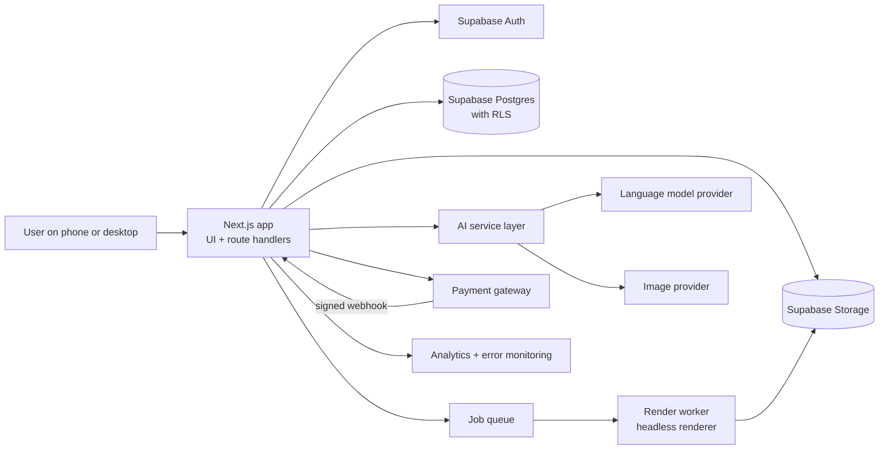
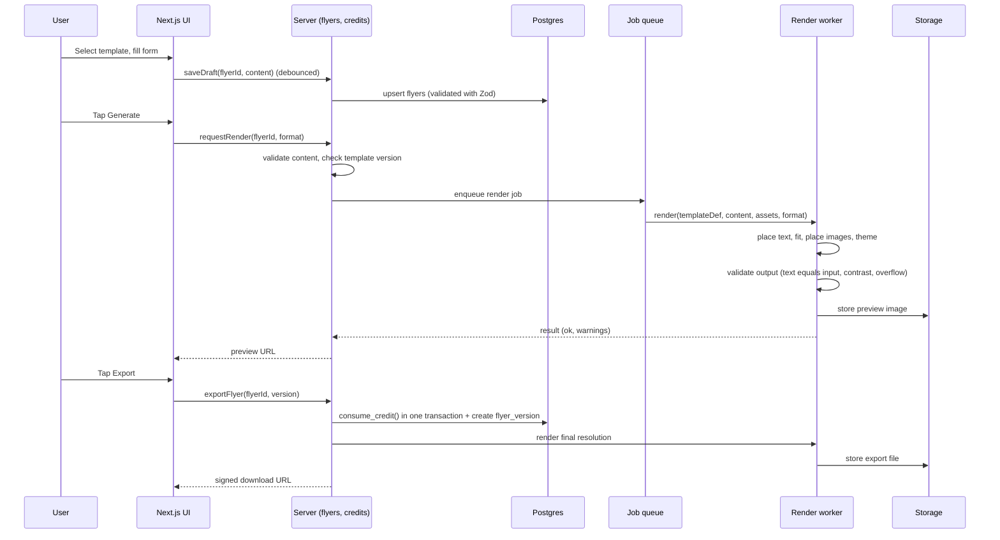
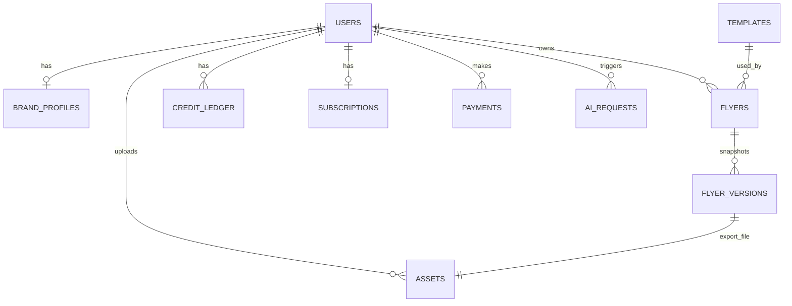

# SharpFlyer AI

AI-powered promotional flyer creation for Nigerian businesses. Users pick a curated template, enter their details (headline, price, phone, logo, product image), and export a professional flyer for WhatsApp Status, Instagram, Facebook, or print.

> **Read this file first.** It explains what the product is, how the system is built, where code lives, and the rules that must never be broken. Humans and AI coding agents should both treat it as the map of the codebase.

| Related doc | Purpose |
|---|---|
| `docs/PRD.md` | What we build and why (requirements FR-xxx, NFR-xxx, AI-xxx) |
| `docs/TEMPLATE_SPEC.md` | Template JSON schema and rendering rules (to be written) |
| `docs/AI_SPEC.md` | Prompts, output schemas, evaluation (to be written) |
| `docs/DECISIONS.md` | Architecture decision log |

---

## 1. Product in 60 seconds

- **Mode A (MVP):** choose a template from the gallery, fill a form, render, export.
- **Mode B (later):** describe a flyer in a prompt; AI produces a design specification that the same renderer draws.
- **Core promise:** prices, phone numbers, business names, and logos are always correct, because they are rendered from structured data and never generated by an image model.
- **Initial market:** solar and inverter businesses in Nigeria. Currency is Naira (₦). Mobile-first. Payments through Paystack or Flutterwave.

## 2. Non-negotiable rules (invariants)

These rules protect accuracy, money, and user data. Do not change behavior that violates them, and add tests whenever code touches them.

1. **Critical text is never produced by an image model.** Business name, price, old price, phone, address, and logo are rendered by the template renderer from user-supplied data.
2. **Rendered critical text must equal the input exactly.** The output validator (FR-006) blocks export on any mismatch.
3. **Credits are an append-only ledger.** Never update or delete ledger rows. Balance is the sum of `delta`. Failed renders never consume credits.
4. **Payments are confirmed only by verified server-side webhooks.** Never trust a client redirect. Webhook handling must be idempotent.
5. **Row-level security (RLS) is on for every user-owned table.** Never use the Supabase service-role key in client code.
6. **Every AI call goes through the AI service layer** (`src/server/ai`). It logs cost and latency, enforces limits, and has a non-AI fallback.
7. **AI output is validated against a schema** (Zod) before use. Treat model output as untrusted input.
8. **All uploads are validated server-side** (MIME type, magic bytes, size, dimensions).
9. **Templates and fonts must be commercially licensed.** Record license info in template metadata.
10. **Mobile first.** Every screen must work at 360px width on a mid-range Android phone.

## 3. Tech stack

| Layer | Choice | Notes |
|---|---|---|
| Frontend | Next.js (App Router), TypeScript, Tailwind CSS | Server components by default; client components only where interaction needs them |
| Backend | Next.js route handlers and server actions | Thin handlers; business logic lives in `src/server` |
| Database | Supabase Postgres | Migrations in `supabase/migrations` |
| Auth | Supabase Auth | Phone OTP, email magic link, Google |
| Storage | Supabase Storage | Private buckets, signed URLs |
| Rendering | Template renderer (HTML/CSS or SVG) to PNG/JPG | Runs in a dedicated render worker (see section 7) |
| AI | Provider-agnostic service layer | Language model for copy and design specs; image provider for background removal and optional backgrounds |
| Payments | Paystack or Flutterwave | Decision pending, wrapped behind a `PaymentProvider` interface |
| Validation | Zod | Shared between client and server |
| Testing | Vitest (unit), Playwright (e2e and visual regression) | |
| Monitoring | Error tracker plus product analytics | Events listed in PRD section 15.3 |

## 4. System architecture



### Responsibilities

| Component | Responsibility | Must not |
|---|---|---|
| Next.js UI | Gallery, form, preview, editor, billing pages | Contain business rules about credits or pricing |
| Route handlers / server actions | Authenticate, validate input, call services, return typed results | Hold long-running work (render and AI run as jobs) |
| Services (`src/server`) | Business logic: flyers, credits, payments, AI, templates | Import from `app/` or UI components |
| Render worker | Turn template definition plus content into an image | Call AI models or touch billing |
| AI service layer | Provider calls, prompt building, schema validation, logging, limits, fallbacks | Let callers talk to providers directly |
| Database | Source of truth, RLS, ledger integrity | Be written to by the client with elevated privileges |

## 5. Repository structure

```
.
├── README.md                     # this file
├── CLAUDE.md                     # short agent instructions (links here)
├── docs/                         # PRD and specs
├── supabase/
│   ├── migrations/               # SQL migrations (source of truth for schema)
│   ├── seed.sql                  # dev seed data
│   └── config.toml
├── templates/                    # version-controlled template definitions (MVP)
│   ├── solar-bold-001/
│   │   ├── template.json         # definition (schema in section 8)
│   │   ├── preview.png
│   │   └── assets/               # fonts, decorative images, with license notes
│   └── ...
├── src/
│   ├── app/                      # Next.js routes (App Router)
│   │   ├── (public)/             # landing, pricing, auth
│   │   ├── (app)/app/            # dashboard, templates, create, flyers, brand, billing
│   │   ├── (admin)/admin/        # admin pages
│   │   └── api/                  # route handlers (webhooks, jobs, uploads)
│   ├── components/               # UI components (ui/, gallery/, editor/, billing/)
│   ├── lib/                      # shared pure utilities (format, validation, env)
│   ├── schemas/                  # Zod schemas shared by client and server
│   ├── server/                   # server-only business logic
│   │   ├── auth/                 # session helpers, role checks
│   │   ├── flyers/               # create, update, duplicate, version, export
│   │   ├── templates/            # load, validate, list templates
│   │   ├── render/               # render orchestration, job creation, validator
│   │   ├── credits/              # ledger, consume, refund, grant
│   │   ├── billing/              # PaymentProvider, webhooks, subscriptions
│   │   ├── ai/                   # AI service layer (section 9)
│   │   ├── storage/              # uploads, signed URLs, validation
│   │   └── analytics/            # typed event tracking
│   └── types/                    # generated DB types and shared TS types
├── render-worker/                # separate Node service for rendering
│   ├── src/
│   │   ├── engine/               # template-to-HTML/SVG, text fitting
│   │   ├── validate/             # output validation (FR-006)
│   │   └── server.ts             # job endpoint
│   └── Dockerfile
├── tests/
│   ├── unit/
│   ├── integration/
│   ├── e2e/
│   └── visual/                   # per-template visual regression
└── .env.example
```

**Dependency direction:** `app` and `components` → `server` and `schemas` → `lib`. `server` must never import from `app` or `components`. `render-worker` shares `schemas` and the template types but not server code.

## 6. Core flows

### 6.1 Create and export a flyer (Mode A)



Key points:
- **Preview vs export:** previews may be lower resolution and cached; export renders at full resolution and is the only step that consumes a credit (once per flyer version).
- **Failure handling:** if the final render fails after a credit is consumed, a refund ledger row is inserted automatically in the same failure path.
- **Determinism:** the same template version plus the same content must produce the same image.

### 6.2 Payment and credits

1. User chooses a plan or credit pack; the server creates a checkout session with the payment provider and records a `payments` row with status `pending`.
2. The provider calls `POST /api/webhooks/payments`.
3. The handler verifies the signature, checks for an existing processed event id (idempotency), confirms the transaction with the provider API, then in one DB transaction marks the payment `succeeded` and inserts the ledger grant or activates the subscription.
4. Duplicate events do nothing.

### 6.3 AI copy suggestion

1. UI calls `suggestCopy` with business type, offer details, tone, and the template's character limits.
2. The AI service layer checks the user's AI allowance and rate limit.
3. It builds the prompt, calls the provider, validates the JSON against `CopySuggestionSchema`, filters invented claims, and logs an `ai_requests` row.
4. On timeout or invalid output it retries once, then returns a typed error so the UI can offer manual entry.

## 7. Rendering architecture

**Why a separate render worker?** Headless Chromium is heavy and often exceeds serverless limits. Running it in a small container (Docker on Fly.io, Railway, Render, or similar) keeps the Next.js app light and lets rendering scale independently. If a lighter approach is sufficient, an SVG pipeline (for example, Satori plus a resvg-based rasterizer) can replace Chromium behind the same interface. Record the final choice in `docs/DECISIONS.md`.

**Render pipeline (inside `render-worker/src/engine`):**

1. **Load** the template definition and pin its version.
2. **Resolve theme:** choose a palette (template palette or brand colors) and map color roles to tokens.
3. **Build the layout tree** from `regions` for the requested format.
4. **Fit text:** for each text region, apply wrapping and shrink within `minFontSize` to `maxFontSize`; optional fields may truncate; required fields that cannot fit produce a warning or failure.
5. **Place images:** apply `contain`, `cover`, or `smart-crop`; keep transparency; apply masks and shadows.
6. **Rasterize** to PNG or JPG at the target pixel size (optional 2x).
7. **Validate** (FR-006): compare rendered text nodes to input, check overflow, contrast, and image quality.
8. **Return** the file plus a result object `{ ok, warnings[], errors[], metrics }`.

**Interface between app and worker:**

```ts
// shared type (src/types/render.ts)
export type RenderRequest = {
  jobId: string;
  templateId: string;
  templateVersion: number;
  format: 'status' | 'ig_post' | 'story' | 'fb_post' | 'a4';
  scale: 1 | 2;
  content: FlyerContent;         // validated structured data
  assets: { logoUrl?: string; productImageUrls: string[] }; // signed URLs
  themeId: string;
  purpose: 'preview' | 'export';
};

export type RenderResult = {
  jobId: string;
  ok: boolean;
  outputUrl?: string;            // storage path, not a public URL
  warnings: RenderIssue[];
  errors: RenderIssue[];
  metrics: { durationMs: number; minFontSizeUsed: number };
};
```

## 8. Template system

Templates are data, not code. The renderer interprets the definition.

```jsonc
// templates/solar-bold-001/template.json (abridged)
{
  "meta": {
    "id": "solar-bold-001",
    "version": 1,
    "title": "Solar Power Package: Bold",
    "category": "solar",
    "tags": ["inverter", "battery", "package"],
    "style": "bold",
    "license": { "author": "Designer Name", "type": "work-for-hire", "fonts": ["Inter", "Poppins"] }
  },
  "formats": {
    "ig_post": { "width": 1080, "height": 1080, "safeArea": 48 },
    "status":  { "width": 1080, "height": 1920, "safeArea": 64 }
  },
  "palettes": [
    { "id": "navy", "roles": { "bg": "#0B1F3A", "primary": "#FFB800", "text": "#FFFFFF", "muted": "#9FB3C8" } }
  ],
  "fields": [
    { "key": "headline", "type": "text", "required": true, "maxLength": 60 },
    { "key": "price", "type": "price", "required": false },
    { "key": "phone", "type": "phone", "required": true },
    { "key": "productImage", "type": "image", "required": false },
    { "key": "logo", "type": "logo", "required": false }
  ],
  "regions": {
    "ig_post": {
      "headline": { "x": 60, "y": 90, "w": 700, "h": 220, "font": "Poppins", "weight": 800,
                    "minSize": 44, "maxSize": 88, "lineHeight": 1.05, "overflow": "shrink", "color": "text" },
      "price":    { "x": 60, "y": 760, "w": 520, "h": 140, "font": "Inter", "weight": 800,
                    "minSize": 48, "maxSize": 96, "color": "primary", "format": "naira" },
      "phone":    { "x": 60, "y": 960, "w": 600, "h": 60, "font": "Inter", "weight": 600,
                    "minSize": 28, "maxSize": 36, "color": "text" },
      "productImage": { "x": 580, "y": 260, "w": 460, "h": 560, "fit": "contain", "shadow": true },
      "logo": { "x": 60, "y": 40, "w": 180, "h": 60, "fit": "contain" }
    }
  },
  "decor": [ { "type": "shape", "kind": "rect", "x": 0, "y": 0, "w": 1080, "h": 1080, "fill": "bg" } ],
  "constraints": { "minContrast": 4.5, "maxHeadlineLines": 3 }
}
```

**Rules**
- The template JSON is validated against `TemplateSchema` (Zod) at load time and in CI.
- Published template versions are immutable. Changes create a new version; existing flyers stay pinned to their version.
- Adding a template must not require code changes unless it needs a new field type or fit mode.

**How to add a template**
1. Design the template (Figma or SVG); export decorative assets.
2. Create `templates/<id>/` with `template.json`, `preview.png`, and `assets/` (include license notes).
3. Run `pnpm templates:validate` (schema check plus sample render).
4. Add a visual regression snapshot for short, normal, long, and extreme content.
5. Run `pnpm templates:sync` to upsert metadata into the `templates` table.
6. Review the output on a real phone before publishing.

## 9. AI service layer (`src/server/ai`)

```
src/server/ai/
├── index.ts            # public functions: suggestCopy, removeBackground, generateBackground, designFromPrompt
├── providers/          # one adapter per provider (llm, image, background-removal)
├── prompts/            # versioned prompt templates (no inline prompts elsewhere)
├── schemas.ts          # Zod schemas for every AI output
├── limits.ts           # per-user and per-IP rate limits, allowance checks
├── cost.ts             # cost calculation and logging
└── fallbacks.ts        # non-AI behavior when a call fails
```

**Public interface pattern**

```ts
export async function suggestCopy(
  userId: string,
  input: CopyRequest
): Promise<Result<CopySuggestions, AIError>> {
  await enforceLimits(userId, 'copy');
  const prompt = buildCopyPrompt(input);               // from prompts/copy.v1.ts
  const raw = await llm.complete(prompt, { timeoutMs: 8000 });
  const parsed = CopySuggestionsSchema.safeParse(raw);
  if (!parsed.success) return retryOnceOrFail(...);
  const safe = removeInventedClaims(parsed.data, input);
  await logAIRequest({ userId, type: 'copy', ...usage });
  return ok(safe);
}
```

**Rules**
- Callers never import provider SDKs directly.
- Prompts live in `prompts/` and are versioned (`copy.v1`, `copy.v2`). Changing a prompt requires re-running the evaluation set in `tests/ai-eval`.
- Image models never generate text, prices, logos, or phone numbers. Background prompts explicitly forbid text.
- Every function returns a typed `Result` with an error code the UI can handle. Errors never consume credits.
- Provider, model name, token usage, cost, latency, and status are logged to `ai_requests`.

## 10. Data model (summary)

Full schema lives in `supabase/migrations`. This is the conceptual map.



| Table | Notes |
|---|---|
| `profiles` / `brand_profiles` | One brand profile per user (MVP) |
| `templates` | Metadata and version; definition JSON is loaded from the repo files or stored JSONB |
| `flyers` | `content` is JSONB validated by `FlyerContentSchema`; pinned `template_version` |
| `flyer_versions` | Immutable snapshots created at export |
| `assets` | Logos, product images, backgrounds, exports; `hash` used for caching |
| `credit_ledger` | Append-only; `delta` integer; `reason` enum |
| `subscriptions`, `payments` | Gateway references; webhook event ids stored for idempotency |
| `ai_requests` | Cost, latency, provider, status |
| `audit_logs` | Admin and sensitive actions |

**RLS examples**

```sql
alter table flyers enable row level security;

create policy "flyers_select_own" on flyers
  for select using (auth.uid() = user_id);
create policy "flyers_insert_own" on flyers
  for insert with check (auth.uid() = user_id);
create policy "flyers_update_own" on flyers
  for update using (auth.uid() = user_id);

-- Ledger: users can read their own rows, never write
alter table credit_ledger enable row level security;
create policy "ledger_select_own" on credit_ledger
  for select using (auth.uid() = user_id);
-- no insert/update/delete policies: writes happen only via server-side functions
```

**Credit consumption (single transaction)**

```sql
-- Pseudocode of the database function consume_credit(user, flyer_version)
-- 1. lock the user's ledger rows (advisory lock on user id)
-- 2. compute balance = sum(delta)
-- 3. if balance < 1 raise 'insufficient_credits'
-- 4. insert ledger row (delta = -1, reason = 'export', reference_id = flyer_version)
-- 5. return new balance
```

## 11. Authentication and authorization

- Sessions are managed by Supabase Auth; server helpers in `src/server/auth` provide `requireUser()` and `requireAdmin()`.
- Every route handler and server action starts with `requireUser()` unless explicitly public.
- Authorization is enforced twice: in code (`requireUser`, ownership checks) and in the database (RLS).
- Admin role is stored server-side (not user-editable) and checked on every admin route.
- OTP endpoints are rate limited per phone number and per IP.

## 12. Uploads and storage

- Buckets: `uploads` (logos and product images), `renders` (previews and exports). Both private.
- Flow: client requests an upload URL → server validates declared type and size → client uploads → server verifies magic bytes and dimensions → asset row created.
- Limits: logo 5 MB, product image 10 MB. Allowed types: PNG, JPG, WebP, and SVG (logos only; SVG is sanitized).
- Downloads use short-lived signed URLs.
- A scheduled job removes orphaned uploads and expired soft-deleted data.

## 13. Error handling and result types

- Server functions return `Result<T, AppError>` instead of throwing for expected failures (validation, insufficient credits, provider timeout).
- `AppError` has a stable `code` (for example, `INSUFFICIENT_CREDITS`, `RENDER_FAILED`, `AI_TIMEOUT`) and a user-safe `message`. The UI maps codes to friendly messages.
- Unexpected exceptions are caught at the boundary, logged to the error tracker, and shown as a generic retryable error.
- Never leak provider errors or stack traces to the client.

## 14. Conventions

| Area | Convention |
|---|---|
| Language | TypeScript, `strict` on, no `any` without a comment |
| Validation | Zod at every boundary (forms, API, AI output, template files) |
| Naming | `camelCase` variables and functions, `PascalCase` components and types, `snake_case` DB columns |
| Components | Server components by default; `"use client"` only for interactive pieces |
| Data fetching | Server-side in route components or server actions; avoid client-side fetching of sensitive data |
| Styling | Tailwind with design tokens; no hard-coded colors outside the design system |
| Money | Store amounts as integers in kobo; format with a shared `formatNaira()` helper |
| Phone numbers | Store E.164; format for display with a shared helper |
| Dates | Store UTC; display in `Africa/Lagos` |
| Commits | Conventional commits; reference requirement IDs (for example, `feat(export): consume credit once per version (FR-008)`) |
| Env vars | Defined and validated in `src/lib/env.ts`; document in `.env.example` |

## 15. Environment variables

```bash
# App
NEXT_PUBLIC_APP_URL=
# Supabase
NEXT_PUBLIC_SUPABASE_URL=
NEXT_PUBLIC_SUPABASE_ANON_KEY=
SUPABASE_SERVICE_ROLE_KEY=          # server only, never exposed to the client
# Payments (one provider initially)
PAYSTACK_SECRET_KEY=
PAYSTACK_WEBHOOK_SECRET=
# AI providers
LLM_API_KEY=
IMAGE_API_KEY=
BG_REMOVAL_API_KEY=
# Render worker
RENDER_WORKER_URL=
RENDER_WORKER_SECRET=
# OTP / email
OTP_PROVIDER_KEY=
EMAIL_PROVIDER_KEY=
# Monitoring
ERROR_TRACKER_DSN=
ANALYTICS_KEY=
```

Only variables prefixed with `NEXT_PUBLIC_` may be used in client code.

## 16. Local development

```bash
# 1. Install
pnpm install

# 2. Start Supabase locally (requires Docker)
supabase start
supabase db reset            # applies migrations and seed.sql

# 3. Environment
cp .env.example .env.local   # fill in keys

# 4. Run the app and the render worker
pnpm dev                     # Next.js at http://localhost:3000
pnpm --filter render-worker dev

# 5. Quality checks
pnpm lint
pnpm typecheck
pnpm test                    # unit and integration
pnpm test:e2e                # Playwright
pnpm test:visual             # template visual regression
pnpm templates:validate      # schema and sample render for all templates
```

## 17. Testing strategy

| Layer | What to test | Examples |
|---|---|---|
| Unit | Pure logic | Naira and phone formatting, text-fit algorithm, credit math, schema validation |
| Integration | Server logic with a test DB | Consume credit, refund on failure, webhook idempotency, RLS isolation between users |
| E2E | User journeys | Sign up → pick template → fill form → export, on mobile and desktop viewports |
| Visual | Render stability | Each template with short, normal, long, and extreme content in every format |
| AI evaluation | Quality of AI features | 50+ sample inputs for copy; check length limits and invented claims |
| Security | Abuse paths | Cross-account access, forged webhooks, malicious uploads, rate limits |

**Release blockers:** critical-text mismatch, cross-account data exposure, credit or payment errors, corrupt exports, broken mobile sign-up or export.

## 18. Deployment

| Component | Target | Notes |
|---|---|---|
| Next.js app | A Next.js-friendly host (for example, Vercel) | Preview deploys per PR |
| Render worker | Container host (Fly.io, Railway, Render, or similar) | Protected by a shared secret; autoscale on queue depth |
| Database and storage | Supabase | Daily backups; migrations applied through CI |
| Webhooks | Public HTTPS endpoint | Signature verified; retries expected |

CI pipeline: lint → typecheck → unit and integration tests → template validation → build → e2e on preview → deploy.

## 19. Observability

- **Errors:** error tracker for the app and worker, with alerts on render failures and webhook failures.
- **Analytics:** typed event helper (`track('export_succeeded', {...})`) matching the PRD event list; no unnecessary personal data.
- **Cost:** daily dashboard of AI cost per request type and per exported flyer; alert when cost per export exceeds the agreed ceiling.
- **Jobs:** log job id, duration, and result for every render.

## 20. Guide for AI coding agents

**Before you code**
1. Read this README and the relevant sections of `docs/PRD.md`.
2. Identify the requirement IDs you are implementing and quote them in your plan.
3. Check the invariants in section 2. If the task conflicts with one, stop and ask.

**While you code**
- Follow the folder structure and dependency direction in section 5.
- Copy existing patterns (one canonical example per layer) instead of inventing new ones.
- Validate every boundary with Zod. Return `Result` types for expected failures.
- Do not add dependencies, change the database schema, or alter RLS policies without describing why and updating the docs.
- Never put secrets or the service-role key in client code or logs.
- Keep changes small and focused; one feature or fix per change.

**Before you finish**
- Run lint, typecheck, and the tests relevant to your change.
- Add or update tests for new behavior, especially for credits, payments, and text accuracy.
- Update docs (`README`, `PRD`, `DECISIONS`) if behavior or architecture changed.
- Summarize what changed, which requirement IDs are covered, and anything left undone.

**Ask a human when**
- Requirements are ambiguous or conflict.
- A change touches billing, auth, RLS, or the credit ledger.
- You need a new provider, dependency, or paid service.
- A template or asset license is unclear.

## 21. Glossary

| Term | Meaning |
|---|---|
| Template | Structured flyer design: fields, regions, fonts, palettes, rules |
| Region | A defined area in a template where a field is drawn |
| Critical fields | Business name, price, phone, address, logo; always rendered from data |
| Mode A / Mode B | Template-based creation / prompt-based creation |
| Flyer version | Immutable snapshot of content, theme, and format used for an export |
| Credit | Unit of usage consumed by exports or paid AI operations |
| Ledger | Append-only record of credit changes |
| Render worker | Service that turns template plus content into an image |
| AI service layer | Single module through which all AI provider calls pass |

## 22. Open decisions (track in `docs/DECISIONS.md`)

- Payment gateway: Paystack or Flutterwave.
- Rendering engine: headless Chromium worker or an SVG-based rasterizer.
- Job queue implementation (database-backed queue, a managed queue, or Supabase-based jobs).
- AI providers for copy, background removal, and background generation.
- OTP channel and provider (SMS or WhatsApp).
- Template storage: repo files only, or database plus admin UI after about 30 templates.
